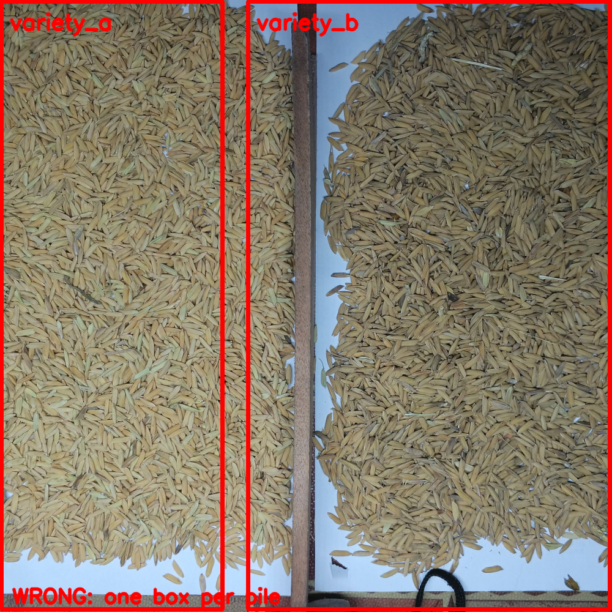
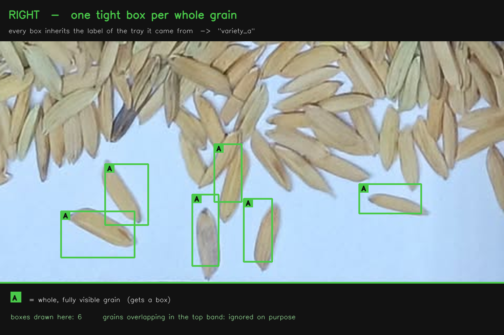
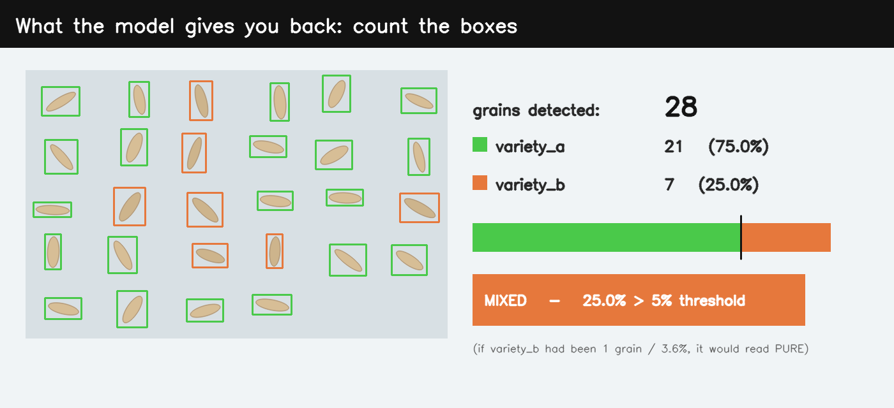
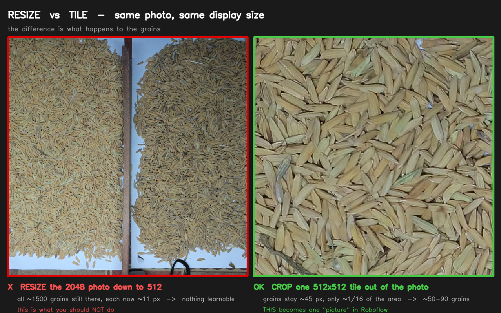
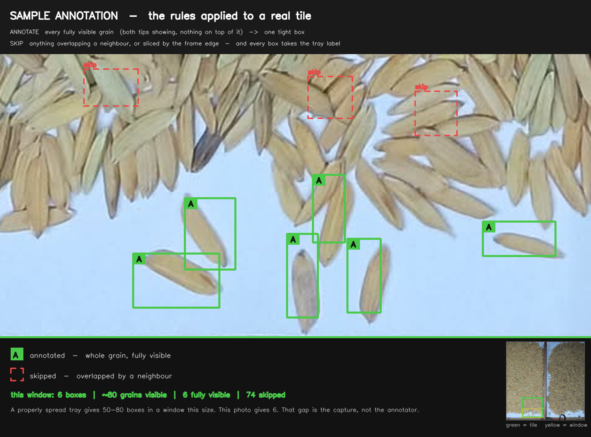

# Palay Detection Prototyping

Guide for capturing and annotating palay images used to train the variety / mixture detector.

Read the [images](#images) at the bottom — they show each rule.

---

## TL;DR — the fixed numbers

| Item | Value |
|---|---|
| Photos per variety | **20** (5 sessions × 4 photos) |
| Photos total (8 varieties) | **160** |
| Tiles annotated per variety | **10** (2 per session) |
| Tiles annotated total | **80** |
| Boxes per tile | **80** |
| Boxes total | **6,400** (800 per variety) |
| Approx. total effort | **~10 hours** |

---

## The core idea

**Annotate grains, not piles.**

- One photo contains **one variety only** → every box in that photo gets that variety's class.
- **Mixture is a count.** Detect every grain, classify it, then count:

```
1,842 grains detected
  variety3: 1,711  (92.9%)
  variety5:   131  ( 7.1%)   -> MIXED
```

- You never annotate a mixed pile. Mixed trays are **test data only** — you photograph them and compare the count against the weight ratio you used.







---

## 1. Scatter — non-negotiable

Grains must be **separated** so their full shape is visible. Shape is the main variety cue; overlap destroys it.

- **Single layer**, no stacking.
- **~20–25% coverage** of the frame — about **one grain-width of white space** between neighbours. This is what makes a 512×512 tile hold ~80 grains.
- **Re-scatter for every shot.** Never reuse the same arrangement.
- A few touching pairs are fine — the model must learn to split them. Do not build a perfect grid.
- Matte background: plain white or light gray. No glossy paper, no wood, no fabric.

**Test before shooting:** can you see both tips of most grains? If no, re-spread.

## 2. Camera and angle

- **Top-down**, phone flat and parallel to the surface.
- **Fixed distance**, 25–30 cm. Consistent framing across the whole session.
- **Two distances** across a session: whole frame + half frame. Teaches scale invariance.
- **A few shots at ±10°** — real users will not hold the phone perfectly flat.
- **No flash.**

## 3. Lighting

- **Diffuse daylight.** No direct sun, no hard shadows, no window frames casting lines.
- Watch your own shadow and your hand's shadow.
- Across sessions, cover: **indoor diffuse**, **window side-light**, **overcast outdoor**.
- **Same exposure and white balance** within one session — set it once, do not touch it.
- Include a white or gray card in frame on the first shot of each session for colour reference.

## 4. How many pictures

8 varieties in scope. These are **fixed targets**, not ranges.

| Item | Value |
|---|---|
| Shooting sessions | **5** |
| Photos per variety per session | **4** |
| **Photos per variety** | **20** |
| **Photos total (all 8 varieties)** | **160** |

**Shoot all 8 varieties in the same session.** Same light, same paper, same camera. This is what stops the model from learning "bright = variety3".

**Hold out session 5 for validation.** Never random-split photos — split by session, or validation lies to you.

Also swap which varieties sit on the left/right when using a two-tray setup, so position never becomes a cue.

One session = 8 varieties × 4 photos ≈ **45 minutes**.

## 5. Annotation rules

**Tile first, then annotate.** One 2048×2048 photo is cut into 512×512 tiles (~20% overlap). Each tile is a separate image in Roboflow.



- **Annotate every fully visible grain in the tile.** **80 boxes per tile.**
- **Skip** any grain that overlaps a neighbour or is sliced by the tile edge.
- **One grain per box. Tight.** Both tips inside the box. Never a box around a group.
- **Never partially annotate a tile.** Unboxed grains are treated as background and actively teach the model to *suppress* grains.
- **Boxes may overlap each other** — two grains lying close together produce two intersecting boxes. That is correct.



**Annotation volume — fixed:**

| Item | Value |
|---|---|
| Tiles annotated per session per variety | **2** |
| **Tiles annotated per variety** | **10** |
| **Tiles annotated total (8 varieties)** | **80** |
| **Boxes per tile** | **80** |
| **Boxes per variety** | **800** |
| **Boxes total** | **6,400** |

Which tiles to pick — 2 per session per variety, so every lighting condition is represented:

```
Session 1..4   ->  8 tiles per variety  ->  training
Session 5      ->  2 tiles per variety  ->  validation + test   (never trained on)
```

Keep class counts within ~2× of each other.

**Time:** ~4 h shooting + ~4 h fixing auto-labels + ~1 h training ≈ **10 hours**, over 1–2 weeks. Do not hand-draw 6,400 boxes — use the auto-label script and correct it.

## 6. Classes

Roboflow class names: lowercase, underscores, no spaces.

| Placeholder | Replace with |
|---|---|
| `variety1` | NSIC 222 |
| `variety2` | Longpin 222 |
| `variety3` | _(fill in)_ |
| `variety4` | _(fill in)_ |
| `variety5` | _(fill in)_ |
| `variety6` | _(fill in)_ |
| `variety7` | _(fill in)_ |
| `variety8` | _(fill in)_ |

> Rename before the first upload — renaming classes later means re-annotating.

If two varieties turn out to be visually near-identical, **merge them or flag `needs_review`**. Do not force 8 classes on classes the camera cannot separate.

## 7. Verifying a mixture

Weigh the grains, then photograph. **No annotation.**

| Tray | Weighed truth | Model should report |
|---|---|---|
| 100% variety1 | 0% other | 0% (±2%) |
| 90 / 10 | 10% | 7–13% |
| 50 / 50 | 50% | 45–55% |
| 10 / 90 | 90% | 87–93% |
| 100% variety2 | 100% | 98–100% |

Stir before spreading — otherwise you measure one patch, not the tray.

If a row is off, the cause is usually: class imbalance, threshold too low, or the two varieties not being separable at all.

## 8. Common mistakes

- All photos taken on the same day — the model learns that day's lighting.
- One variety always shot under different light — that variety becomes "the yellow one".
- Annotating 40 grains in a tile containing 500 — 460 false negatives.
- Splitting train/validation by tile instead of by session.
- Training on neat scattered trays, then testing on dense piles.
- Boxing a pair of grains together.
- Expecting a mixture ratio without per-grain boxes — there is no count to divide.

---

## Images

| File | Shows |
|---|---|
| `images/01_wrong_way.png` | One box per pile — the shortcut that teaches position, not grain |
| `images/02_right_way.png` | One tight box per fully visible grain |
| `images/03_boxes_to_mixture.png` | How box counts become a mixture percentage |
| `images/04_tile_vs_resize.png` | Resize (wrong) vs tile (right) |
| `images/05_sample_annotation.png` | Rules applied to a real tile, with skipped grains marked |
